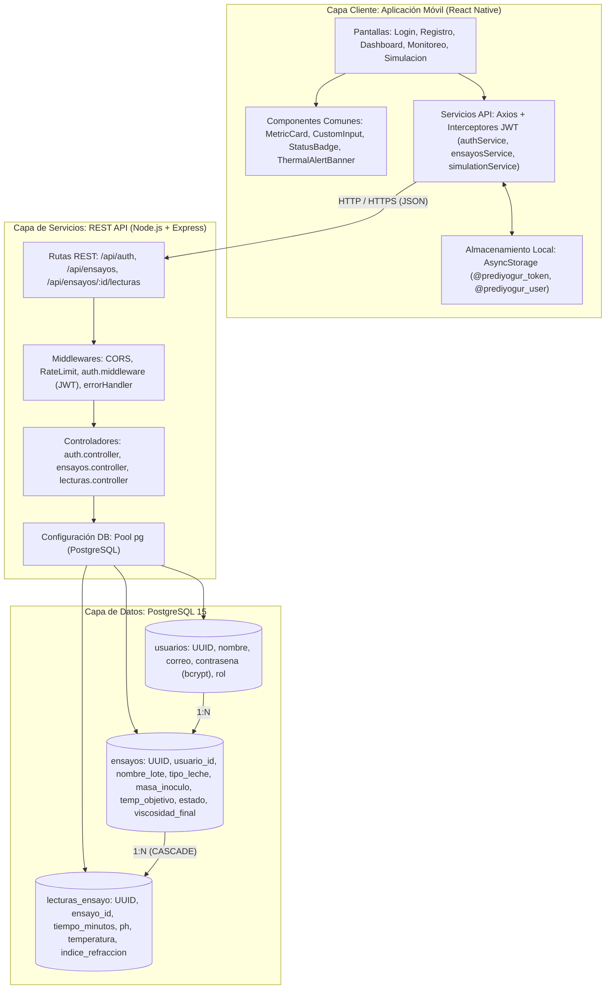

# Arquitectura del Sistema PrediYogur

**Plataforma Científica y Didáctica para el Monitoreo, Predicción y Simulación de pH en Fermentación Láctea**  
*Facultad de Ciencias de la Vida y Tecnologías — Universidad Laica Eloy Alfaro de Manabí (ULEAM)*  
*Investigador Patrocinador: Dr. Stalin Gustavo Santacruz Terán*  
*Director de Proyecto: Carlos Delgado*

---

## 🏗️ 1. Diagrama de Arquitectura Global de 3 Capas

---

## 🔬 2. Reglas Fisicoquímicas y Biológicas del Cliente

El sistema modela el proceso de fermentación de bacterias ácido-lácticas termófilas (*Streptococcus thermophilus* y *Lactobacillus delbrueckii subsp. bulgaricus*):

1. **Cinética de Acidificación**:
   * Las bacterias consumen azúcares solubles (lactosa en leche de vaca; glucosa/sacarosa en matrices vegetales como chocho y coco) y producen ácido láctico.
   * El pH desciende gradualmente desde valores iniciales de $\sim 6.2 - 6.6$ hacia el límite isoeléctrico de las caseínas.
2. **pH Estricto de Corte ($4.50$)**:
   * Al alcanzar $\text{pH} = 4.5$, el ensayo se suspende obligatoriamente para evitar sobre-acidificación y sinéresis del gel lácteo.
3. **Control Térmico Estricto ($41.0\text{ °C} - 43.0\text{ °C}$)**:
   * El punto óptimo de fermentación es $42.0\text{ °C}$ en baño maría.
   * Temperaturas $< 41.0\text{ °C}$ ralentizan el metabolismo bacteriano.
   * Temperaturas $> 43.0\text{ °C}$ provocan desnaturalización y estrés térmico, colapsando la firmeza del yogur.
4. **Dosificación de Inóculo Comercial Chivería**:
   * Se dosifica y pesa rigurosamente en gramos ($g$). Las concentraciones típicas evaluadas en el laboratorio son $2.5\%$ ($6.25\text{ g}/250\text{ g}$) y $7.5\%$ ($18.75\text{ g}/250\text{ g}$).
5. **Control Reológico Final Obligatorio**:
   * Al detener el proceso en $\text{pH } 4.5$, se registra obligatoriamente la **Viscosidad Final** en $mPa\cdot s$ (medida con viscosímetro rotacional, rotor 4 a 60 rpm).
   * La condición óptima ($42\text{ °C} / 7.5\%$ inóculo) alcanza $2639\text{ mPa}\cdot\text{s}$. Desviaciones térmicas a $40\text{ °C}$ o $44\text{ °C}$ reducen la viscosidad a $<800\text{ mPa}\cdot\text{s}$.
6. **Consumo de Azúcares (°Brix)**:
   * El índice de refracción disminuye de $\sim 10.2 - 13.3\text{ °Brix}$ hacia $\sim 5.5 - 7.5\text{ °Brix}$, sirviendo como indicador cinético complementario.

---

## 🔒 3. Seguridad y Control de Acceso

* **Autenticación**: JSON Web Tokens (JWT) firmados con secreto del entorno (`JWT_SECRET`) y expiración en 7 días.
* **Cifrado**: Contraseñas hasheadas en backend con `bcryptjs` (salt rounds: 10).
* **Control de Acceso Basado en Roles (RBAC)**:
  * `estudiante`: Registro de lecturas y consultas.
  * `investigador`: Creación y finalización de ensayos experimentales.
  * `docente`: Supervisión y visualización global.
* **Manejo de Tasa de Peticiones**: `express-rate-limit` protegiendo los endpoints contra abusos y ataques de fuerza bruta.
